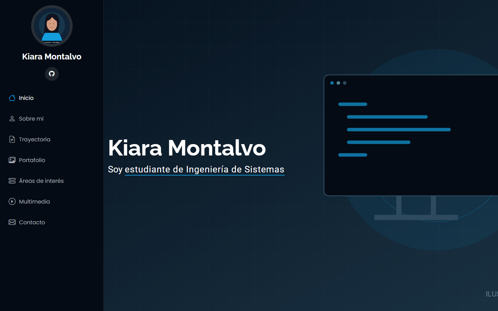
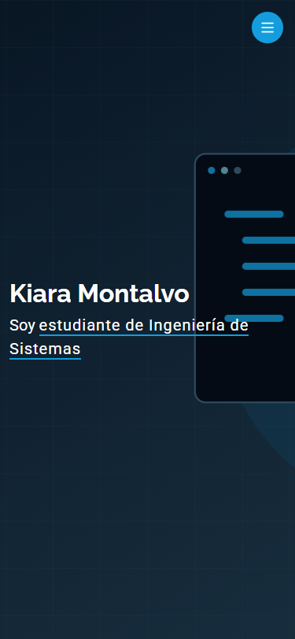

# Portafolio multimedia de Kiara Montalvo

Portafolio académico en español construido con Angular 22.2.2 y la plantilla **iPortfolio de BootstrapMade** incluida en el ZIP original. Mantiene su `main.css` sin modificar, Bootstrap 5.3.3, tipografías, disposición, colores y clases originales. Las fotos de ejemplo se sustituyeron por ilustraciones SVG propias y marcadas como ficticias, según la autorización de la usuaria.

## Ejecutar

Requiere Node **^22.22.3, ^24.15.0 o >=26.0.0** y npm. La versión 24.14.1 no cumple el requisito de Angular 22.

```sh
npm ci
npm start
```

Abrir http://localhost:4200/. Para producción: `npm run build`. Para GitHub Pages: `npm run build:pages`. La salida está en `dist/perfil/browser`.

## Contenido y estructura

- `public/data/`: perfil, cifras, habilidades, trayectoria, proyectos, áreas de interés y testimonios. Todos los registros se cargan con HttpClient; sin base de datos.
- `public/assets/css/main.css`: original sin modificar. Ajustes funcionales para hosts Angular en `src/styles.css`.
- `public/assets/vendor/`: bibliotecas originales de la plantilla. `assets/js/main.js` se conserva como referencia y no se ejecuta: su lógica se integra en `UiService` con inicialización después del renderizado y limpieza al destruir componentes.
- `public/assets/img/`: SVG propios de demostración. No hay fotografías de personas ajenas ni imágenes de ejemplo de BootstrapMade.
- `public/assets/media/`: presentación animada sin voz y melodía instrumental ficticias, de 8 segundos cada una.
- `src/app/core/`: modelos estrictos, DataService y adaptaciones de AOS, Typed.js, PureCounter, Isotope, GLightbox y Swiper. Las barras usan IntersectionObserver en lugar de Waypoints.
- `src/app/layout/`, `sections/`, `pages/`: componentes standalone con signals, `@if` y `@for`.
- Rutas: `/`, `/portfolio/:id`, `/services/:id` y página de enlaces desconocidos.
- `docs/`: capturas y evidencia de QA.

## Datos reales y ficticios

Datos proporcionados: nombre completo Kiara Laleshca Montalvo Rimbaldo, 20 años, cumpleaños 10/02/2006, Ingeniería de Sistemas en Unifranz y colegio Consorcio La Inmaculada (se normalizó la errata del archivo original).

Biografía, roles, ubicación en La Paz, cifras, porcentajes, actividades, fechas y seis proyectos son demostraciones ficticias. Los testimonios están marcados individualmente como ficticios; no representan avales reales. Email, teléfono y sitio personal están vacíos y se muestran como **TODO completar**. El enlace de GitHub proviene del repositorio indicado. Sustituir estos datos antes de usar el portafolio como presentación profesional.

Para reemplazar medios, copiar archivos a `public/assets/img/` o `public/assets/media/` y actualizar rutas, descripciones y textos alternativos en los JSON. Para video con voz, añadir subtítulos y transcripción. El video actual no tiene voz y su texto está descrito debajo del reproductor.

## Formulario y mapa

Reactive Forms valida nombre, email, asunto y mensaje de 10 a 2000 caracteres. El botón **Probar envío** simula éxito en pantalla; no envía correos, no guarda mensajes en localStorage y no imprime datos personales. Se explica también en la interfaz. No requiere backend. El mapa usa la ubicación ficticia de `profile.json` y depende de Google Maps y conexión a Internet. Las fuentes Google originales también requieren conexión.

## Verificación

```sh
npm test
npm run build
npm run build:pages
```

Pruebas de formulario y recuperación de carga de datos, más verificación de navegador para filtros, lightbox, carruseles, rutas y recarga, menú móvil, contadores, barras, imágenes y reproducción de multimedia. Anchos revisados: 1440, 768 y 375 px. Capturas en `docs/`.




## GitHub Pages

Repositorio indicado: https://github.com/kiaramontalvorimbaldo-cmyk/perfil.git

```sh
npm run deploy
```

Publica la compilación en `gh-pages`. En Settings → Pages seleccionar **Deploy from a branch**, rama `gh-pages`, carpeta raíz. La compilación usa `/perfil/`, crea `404.html` para recarga de rutas y conserva `.nojekyll`. URL prevista: https://kiaramontalvorimbaldo-cmyk.github.io/perfil/

El resultado real de publicación y la evidencia final se registran en `docs/ENTREGA.md`; esta URL no implica que el sitio haya sido activado.

## Créditos

iPortfolio: https://bootstrapmade.com/iportfolio-bootstrap-portfolio-websites-template/
Referencia indicada: https://builder.bootstrapmade.com/demo/iPortfolio/
Se conserva **Designed by BootstrapMade** y el enlace adicional DevTools del footer original. Consultar la licencia de la plantilla en https://bootstrapmade.com/license/. Bibliotecas de terceros mantienen sus avisos y licencias. SVG, video y audio de demostración se crearon para este proyecto.

`AGENTE.md` conserva el plan original. La instrucción directa de la usuaria autorizó continuar los sprints sin pausas de aprobación y reservar el resumen para el final.
